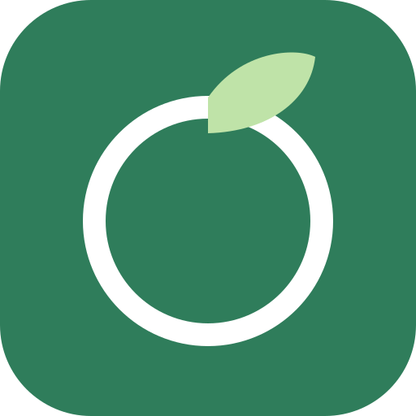
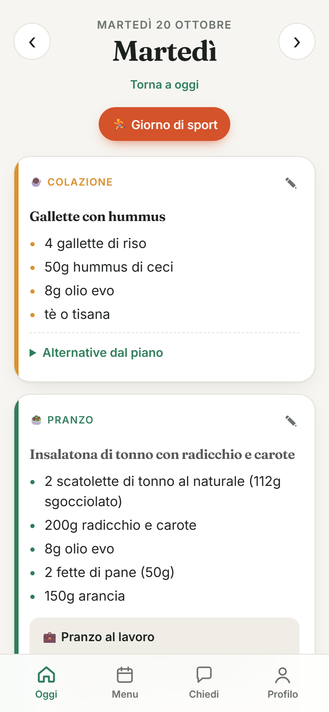
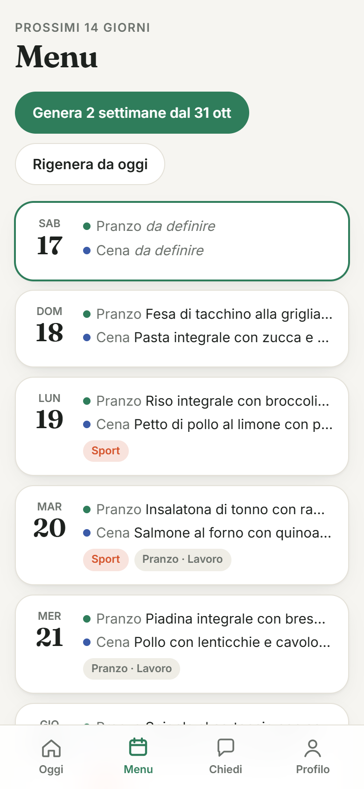
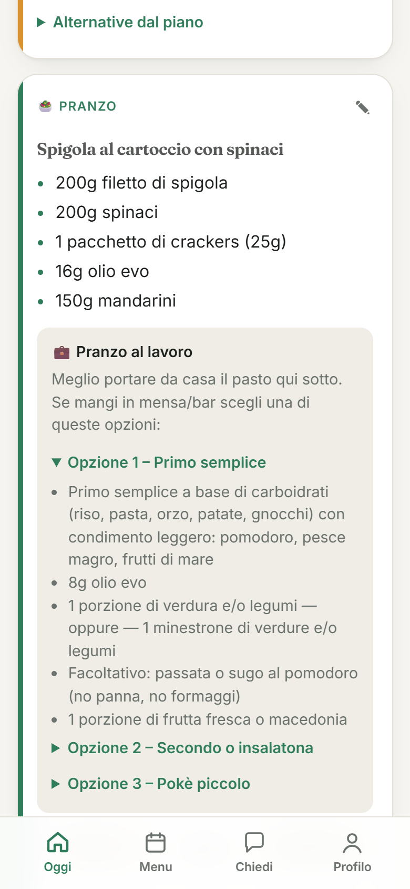
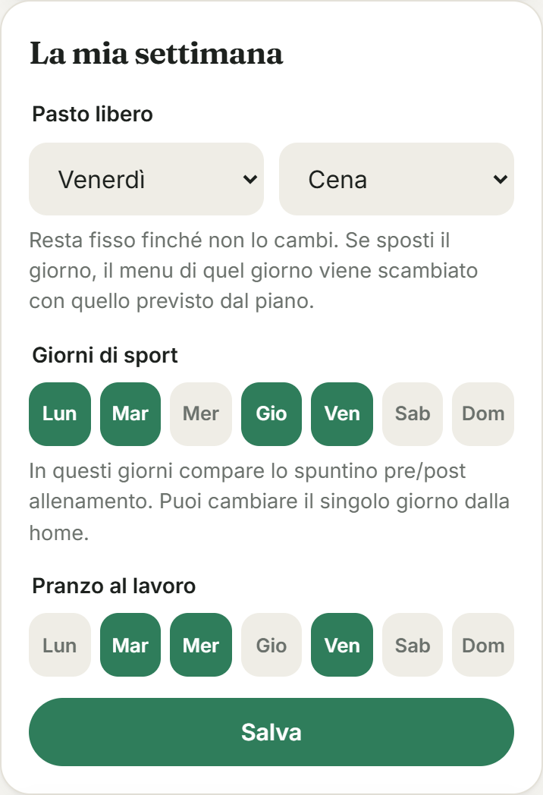
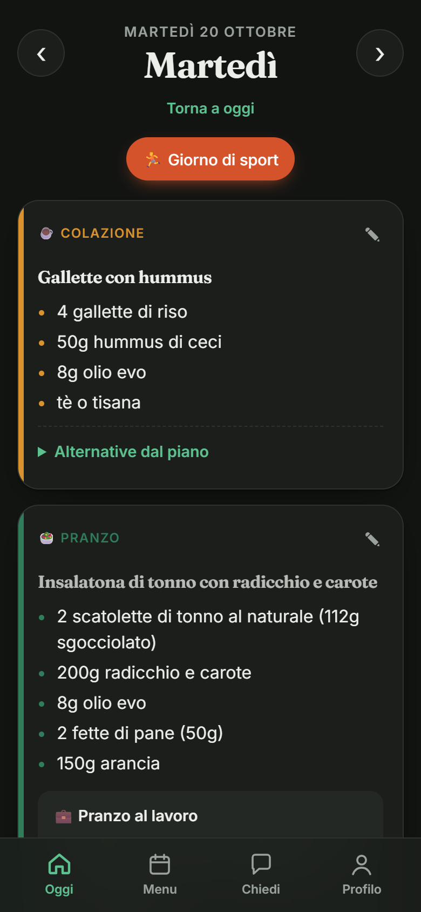

<div align="center">



# DailyMeal

**Il piano alimentare del tuo nutrizionista, trasformato in un menu quotidiano.**

Carichi il PDF, l'AI lo legge e ti prepara due settimane di pasti concreti, con grammature,
sport, pranzi al lavoro e pasto libero. Self-hosted, leggera, pensata per lo smartphone.


<br>

&nbsp;
&nbsp;


</div>

---

## Perché

Il piano del nutrizionista dice "100g di cereali **oppure** 250g di gnocchi, 200g di verdure, 150g di
frutta". Ogni giorno bisogna decidere *cosa* cucinare, ricordarsi che il martedì c'è calcetto, che
mercoledì si pranza in ufficio e che il pasto libero quest'anno è il venerdì. DailyMeal lo fa per te.

## Funzionalità

| | |
|---|---|
| 📄 **Lettura del PDF** | Il piano viene trasformato in dati strutturati: giorni, pasti, alternative, facoltativi, regole, glossario, consigli. |
| 🍽️ **Menu di 2 settimane** | Piatti concreti con grammature, frutta e verdura di stagione, alternative variate. Ogni pasto è **modificabile** e mostra le opzioni del piano. |
| ♥ **Preferiti** | I pasti che modifichi o a cui metti "mi piace" vengono salvati, proposti come scorciatoia quando modifichi e riproposti dai menu generati in seguito (stesso pasto, stesso giorno del piano). |
| ☀️ **Oggi** | Pasti del giorno + consigli contestuali (sport, pasti fuori, pasto libero) e consigli del piano a rotazione. |
| 🏃 **Sport** | Giorni fissi o singolo giorno: compare lo spuntino pre/post allenamento. |
| 💼 **Pasti fuori** | Per pranzo e cena: Casa / Lavoro / Ristorante, con le indicazioni del piano per mangiare fuori. Pranzo al lavoro ricorrente. |
| 🎉 **Pasto libero** | Giorno e pasto fissi finché non li cambi. Se lo sposti, i menu dei due giorni si scambiano, come prevedono i piani. |
| 💬 **Chiedi** | Domande libere sul *tuo* piano: "posso sostituire il pesce con la carne?", "l'orata è un pesce magro?". |
| ⚖️ **Peso** | Registro settimanale con grafico. |
| 👥 **Multi-utente** | Ognuno il suo account, piano e menu. |
| 🌗 **Mobile first** | PWA installabile, tema chiaro e scuro automatico. |

<p align="center">
&nbsp;&nbsp;

</p>

## Avvio rapido (Docker)

```bash
git clone https://github.com/<utente>/dailymeal.git
cd dailymeal
cp .env.example .env    # imposta il motore AI (vedi sotto)
docker compose up -d --build
```

Apri `http://<server>:3000`, registra il primo utente e carica il PDF dal **Profilo**.
Su smartphone: *Condividi → Aggiungi a schermata Home*.

> Il primo utente può sempre registrarsi. Per aggiungerne altri metti `ALLOW_SIGNUP=true`,
> crea gli account, poi rimettilo a `false`.

## Motore AI

DailyMeal usa l'AI per tre cose: leggere il PDF, scrivere il menu e rispondere alle domande.
Tutto il resto (vista giornaliera, sport, pasti fuori, pasto libero, peso) è logica locale.

### Claude (default)

```env
AI_PROVIDER=anthropic
ANTHROPIC_API_KEY=sk-ant-...
# CLAUDE_MODEL=claude-opus-5-5
```

Legge anche i PDF scansionati. Un piano + 2 settimane di menu costano qualche decina di centesimi.

### LLM locale con llama.cpp

```env
AI_PROVIDER=llamacpp
LLAMACPP_URL=http://192.168.1.50:8080
# LLAMACPP_TIMEOUT_MIN=30
```

```bash
llama-server -m modello.gguf --host 0.0.0.0 --port 8080 -c 32768 --jinja
```

- Contesto di almeno **16k** token, meglio 32k.
- Serve un modello che segua bene le istruzioni in italiano: Qwen3 14B+, Gemma 3 12B+, Mistral Small 24B.
- L'output è vincolato con `response_format: json_schema`, quindi la struttura è sempre valida.
- Il testo del PDF viene estratto dall'app: i PDF solo-immagine richiedono Claude.
- Su hardware consumer l'elaborazione richiede decine di minuti; avviene in background.

## Configurazione

| Variabile | Default | Descrizione |
|---|---|---|
| `AI_PROVIDER` | `anthropic` | `anthropic` oppure `llamacpp` |
| `ANTHROPIC_API_KEY` | | Chiave API Anthropic |
| `CLAUDE_MODEL` | `claude-opus-5-5` | Modello Claude |
| `LLAMACPP_URL` | `http://localhost:8080` | Indirizzo di `llama-server` |
| `LLAMACPP_TIMEOUT_MIN` | `30` | Tempo massimo per risposta del modello locale |
| `ALLOW_SIGNUP` | `false` | Registrazione aperta (il primo utente può sempre registrarsi) |
| `TRUST_PROXY` | `false` | `true` dietro un reverse proxy HTTPS |
| `PORT` | `3000` | Porta HTTP |
| `DB_PATH` | `./data/dailymeal.db` | File SQLite (`/data/dailymeal.db` in Docker) |

## Architettura

```
public/            SPA in HTML/CSS/JS, nessun build step
server/
  index.js         API Express, autenticazione (scrypt + cookie di sessione), job in background
  ai.js            Claude / llama.cpp: lettura PDF, menu, domande (JSON schema)
  day.js           composizione della giornata: pasto libero, sport, pasti fuori, consigli
  db.js            SQLite integrato in Node (node:sqlite)
```

Dipendenze runtime: `express`, `@anthropic-ai/sdk`, `unpdf`. Circa 60 MB di RAM.

## Sicurezza e privacy

- I dati restano sul tuo server, in un unico file SQLite (volume Docker `dailymeal-data`).
- Il PDF viene inviato solo al motore AI scelto: Anthropic, oppure il tuo `llama-server` locale.
- Non esporre la porta direttamente su Internet: usa un reverse proxy HTTPS o una VPN (Tailscale, WireGuard).

Backup:

```bash
docker run --rm -v dailymeal_dailymeal-data:/data -v "$PWD":/backup alpine cp /data/dailymeal.db /backup/
```

## Sviluppo

```bash
npm install
npm test        # logica della giornata
npm run dev     # http://localhost:3000
```

## Avvertenza

DailyMeal aiuta a *seguire* un piano scritto da un professionista. Non sostituisce il nutrizionista:
i menu generati dall'AI vanno verificati, e per dubbi di salute chiedi a chi ti segue.
